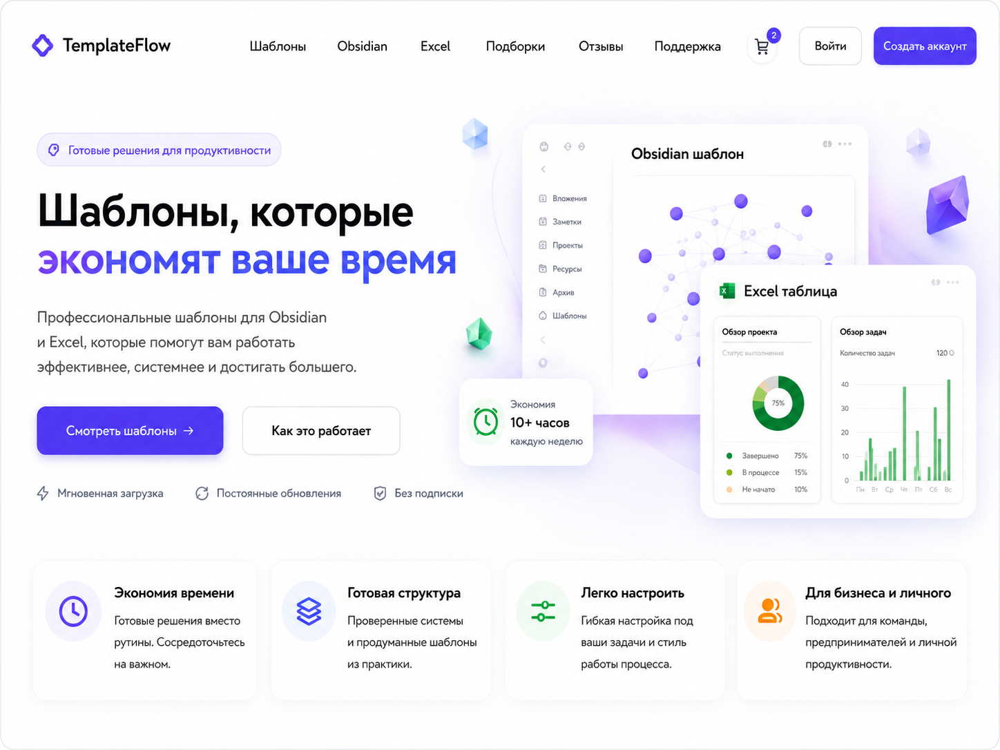

# TemplateFlow

Online store of digital templates for Obsidian and Excel, built from the design mockups in `design/`. Guest checkout by email, payment, instant automatic delivery of files and an admin panel.



## Tech stack

- Next.js 15 (App Router), React 19, TypeScript, Tailwind CSS 4
- SQLite (better-sqlite3)
- Nodemailer (email), marked (Markdown product descriptions)
- Payments: built-in mock provider or YooKassa

## Getting started

```bash
npm install
npm run dev        # http://localhost:3000
```

On the first run the app creates the `data/shop.db` database and seeds a catalog of 6 templates (3 Obsidian + 3 Excel) with demo zip files in `storage/files/`.

## Pages

| Page | URL |
|---|---|
| Home (landing from the mockups) | `/` |
| Catalog, filter by category | `/templates`, `/templates?cat=obsidian` |
| Product page | `/templates/[slug]` |
| Cart and checkout | `/cart` |
| Test payment page | `/pay/[orderId]` |
| Order page (file access) | `/orders/[orderId]?key=…` |
| Restore purchases by email | `/my` |
| Admin panel | `/admin` |

## How templates are sold and delivered

1. **Cart → checkout.** No sign-up: the buyer only enters an email. `POST /api/checkout` creates an order with the `pending` status and returns a payment URL.
2. **Payment.** The provider is set with `PAYMENT_PROVIDER` in `.env.local`:
   - `mock` (default): built-in test payment page that works out of the box;
   - `yookassa`: real YooKassa payments. The payment is created through the API, the buyer is redirected to the payment page, and confirmation comes to the webhook `POST /api/pay/yookassa-webhook` (`payment.succeeded` event, verified with a request back to the YooKassa API). Requires `YOOKASSA_SHOP_ID` and `YOOKASSA_SECRET_KEY`.
3. **Instant automatic delivery.** When the payment is confirmed:
   - the order is marked `paid` (idempotent, so a repeated webhook is safe);
   - each item gets a permanent download token (48 hex characters);
   - the buyer gets an email with download links and a link to the order page (without SMTP the email is printed to the server console);
   - the order page shows "Download" buttons right away.
4. **Download.** `GET /api/download/[token]` checks the token and the order status and serves the file from the private `storage/files/` folder, which is not reachable from the web. Download counters are stored for orders and products.
5. **Lifetime updates.** Links never expire. When the admin replaces a product file, buyers download the new version from their old links.
6. **Lost link.** On `/my` the buyer enters an email and receives links to all their paid orders. The API response is the same for any email, so nobody can check someone else's purchases.

## Admin panel (`/admin`)

- **Dashboard:** revenue, orders, downloads, top sellers.
- **Products:** create, edit and delete products with title, category, tag, price and descriptions. Upload a preview image (to `public/previews/`) and the product file (to the private `storage/files/`). Product descriptions are written in Markdown. Gallery slides support multiple uploads and deletion. A product that already has purchases is taken off sale instead of being deleted, so delivery keeps working.
- **Orders:** list with statuses and a "Mark as paid" button for manual delivery (for example, after a bank transfer).

Sign-in uses `ADMIN_PASSWORD`. The session is an HMAC-signed cookie valid for 7 days.

## Environment variables

Set these in `.env.local`:

| Variable | Purpose |
|---|---|
| `ADMIN_PASSWORD` | Admin panel password (change the default) |
| `AUTH_SECRET` | Secret for signing session cookies (required in production) |
| `SITE_URL` | Public site URL used in emails and payment redirects |
| `PAYMENT_PROVIDER` | `mock` or `yookassa` |
| `YOOKASSA_SHOP_ID`, `YOOKASSA_SECRET_KEY` | YooKassa credentials |
| `SMTP_HOST`, `SMTP_PORT`, `SMTP_USER`, `SMTP_PASS`, `MAIL_FROM` | Email delivery. Without them emails are logged to the console |
